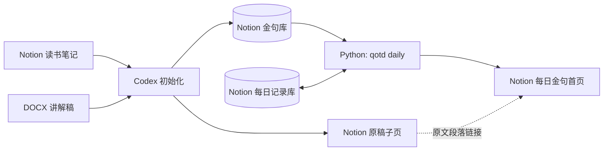

# 🌤️ 每日金句

每天从 Notion 读书笔记中随机选一句，连同书名和讲解稿上下文，发布到适合手机阅读的 Notion 页面。

[打开每日金句](https://www.notion.so/3fb2e3a6cfa6814a9371f5d09d3dd265) · [查看后台数据](https://www.notion.so/3fb2e3a6cfa681a483b2dda0d782d9d1)

## 简介

**Notion 是唯一的业务数据源，也是阅读界面。** Codex 负责导入书稿、核对摘抄与定位原文；这个 Python 项目只做随机抽取和发布，不解析 DOCX，也不调用 AI API。

首页保持六个原生 Notion 区块，手机上自然换行：

```text
2026年10月19日 星期一

❝ 金句　——《书名》

  金句所在的完整段落；对应文字以粗体和灰色背景标出。

  读书讲解稿 · 第N节第M段
```

实际页面在金句、原文和位置链接之间留有空白；书名链接指向读书笔记，位置链接直达原稿段落。没有感想区或额外的网页 UI。

## 快速开始

需要 **Python 3.12+**、[uv](https://docs.astral.sh/uv/) 和一个有读写权限的 Notion 连接。本仓库已绑定现有的“每日金句”首页、金句库和每日记录库；在其他 Notion 工作区使用时，须先建立相同结构并调整 [`settings.py`](src/qotd/settings.py) 中的对象 ID。

1. 下载项目并安装锁定的依赖：

   ```sh
   git clone https://github.com/rayliu40k/qotd.git
   cd qotd
   uv sync --locked
   ```

2. 配置密钥。将 Notion 连接授权给读书笔记库、[每日金句首页](https://www.notion.so/3fb2e3a6cfa6814a9371f5d09d3dd265)和[后台数据页](https://www.notion.so/3fb2e3a6cfa681a483b2dda0d782d9d1)，再填写本地 `.env`：

   ```sh
   cp .env.example .env
   chmod 600 .env
   # 编辑 .env，填入真实的 NOTION_TOKEN；不要把密钥提交到 Git
   ```

3. 手动发布北京时间当天的金句：

   ```sh
   uv run qotd daily
   ```

运行成功后打开[每日金句首页](https://www.notion.so/3fb2e3a6cfa6814a9371f5d09d3dd265)查看结果。**每运行一次都会重新抽取**；同一天再次运行会覆盖当天展示，不会新增第二条每日记录。

## 架构设计



| Notion 对象 | 用途 |
| --- | --- |
| 读书笔记 | 保存书籍信息和原始摘抄；每本书下有讲解稿附件与逐段原文。 |
| 金句库 | 每条摘抄一页，关联书籍、完整原文、位置链接和“参与轮换”开关。 |
| 每日记录库 | 每天最多一页，保存最后一次发布的金句、轮次与展示快照。 |
| 每日金句首页 | 仅展示当天日期、金句、出处和相关原文。 |

数据只保存在 Notion。本地的 `.env`、配置、日志和进程锁不保存金句或轮换历史。

## 发布规则

- 只从开启“参与轮换”的金句中随机选择。当前轮每句展示一次后进入下一轮；新增金句可加入当前轮。
- 轮次根据**今天以前**的最终每日记录计算。当天重发时旧选句不计入历史，新选句也可能碰巧相同。
- 先保存当天记录与快照，再更新首页，最后标记“已发布”。失败后可重新运行；若发现重复日期或页面结构被改动，程序会停止，避免覆盖其他内容。
- 直接摘抄在发布时匹配原文并高亮；概括性金句使用 Codex 初始化时标注的灰色原句范围。缺少可靠上下文时显示“原文待补充”。

## 新增书籍

向 Codex 提供**已有的 Notion 书籍笔记**和原稿路径，调用 `$initialize-daily-quote-book`。Codex 会核对摘抄、导入原稿、建立段落链接并更新金句库；`qotd daily` 不负责初始化，也不会自动同步后来手工修改的笔记。

```text
使用 $initialize-daily-quote-book 初始化《书名》
原稿：/绝对路径/书名.docx
```

直接修改 Notion 摘抄后，请再次让 Codex 核对金句库。讲解稿和出版书籍原文应按实际来源区分。

## macOS 定时运行

项目提供 [LaunchAgent 配置](launchd/com.rayliu.qotd.daily.plist)，模板按 **Mac 系统时区每天 11:00** 执行。先完成手动发布验证，再按 [launchd 操作指南](launchd/README.md)安装、查看状态或停用；配置文件不会因编辑而自动重新加载。`kickstart` 会立即重发当天金句。

## 配置、日志与检查

| 文件 | 内容 |
| --- | --- |
| `.env` | `NOTION_TOKEN`；仅存本机，权限应为 `600`，不提交。 |
| [`qotd.toml`](qotd.toml) | 可调整的 Notion 页面链接模板。 |
| [`settings.py`](src/qotd/settings.py) | 固定的页面与数据源 ID、字段名、状态及技术限制。 |
| `logs/qotd_YYYY-MM-DD.log` | 与控制台同步的 Loguru 日志；保留最近 7 天，单文件上限 500 MB。 |

```sh
uv run pytest -q
uv run ruff check .
uv run ruff format --check .
```

测试使用模拟数据，不会往真实 Notion 写入测试日期。发布命令会修改真实首页和当天记录；需要从其他目录运行时，指定项目与配置的绝对路径：

```sh
uv run --project /usr/local/codex-workspace/qotd qotd daily --config /usr/local/codex-workspace/qotd/qotd.toml
```
